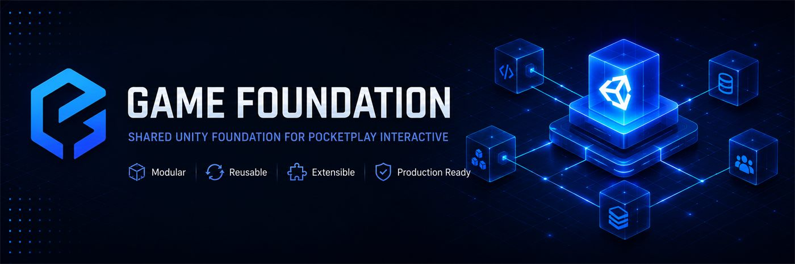

<p align="center">
  
</p>

<h1 align="center">⚡ Game Foundation</h1>

<p align="center">
  <strong>Nền tảng Unity dùng chung cho hệ sinh thái game của PocketPlay Interactive.</strong>
  <br/>
  Tái sử dụng nhanh hơn. Mở rộng sạch hơn. Khởi động dự án mới gọn hơn.
</p>

<p align="center">
  
  
  
  
  
  <a href="CHANGELOG.md"></a>
</p>

---

Core Unity dùng chung: bootstrap, lưu dữ liệu, audio, pooling, UI và các tiện ích nền. Code gameplay, giao diện và cấu hình riêng đặt trong project game.

**Yêu cầu:** Unity 2022.3 trở lên. Package ID: `com.dann.gamefoundation`.

## Bắt đầu nhanh

1. Trong Unity, mở **Window → Package Manager → + → Add package from git URL...** và nhập:

   ```text
   https://github.com/PocketPlay-Interactive/_GameFoundation.git
   ```

   Repository private cần Git credentials phù hợp. Với bản local, chọn **Add package from disk...** và chọn `package.json` của Game Foundation.
2. Mở scene đầu tiên, chọn **GameFoundation → Scene → Create Minimal Setup**. Menu tạo `Manager`, `ManagerCoordinator` và `Concurrency` trong scene. Chọn **Create Full Setup** nếu cần thêm loading, UI manager và audio.
3. Thêm gameplay và UI của game vào scene. Nếu cần khởi tạo data riêng, thêm một [module của game](#module-của-game).
4. Lưu scene và đưa scene vào build settings.

`Manager` đọc save khi khởi động, khởi tạo các module rồi phát `OnFoundationReady`. `ManagerCoordinator` mặc định có thời gian loading tối thiểu 15 giây; chỉnh `Completion Delay Seconds` trong Inspector theo game. Nếu tắt `Auto Complete On Timeout`, game cần gọi `CompleteLoading()` để kết thúc loading.

## Mở rộng từng phần

<details>
<summary><strong>Module của game</strong> — khởi tạo logic riêng mà không sửa core</summary>

Đặt script trong project game, ví dụ `Assets/_Project/ProjectBootstrapModule.cs`:

```csharp
using System.Collections;

public class ProjectBootstrapModule : GameFoundationModuleBehaviour
{
    public override IEnumerator Initialize()
    {
        // Khởi tạo data và service riêng của game tại đây.
        yield break;
    }
}
```

Gắn component vào scene, kéo component vào **Manager → Extension Modules**. Module chạy theo `Order`, sau khi save đã được đọc. Cũng có thể đăng ký object implement `IGameFoundationModule` qua `GameFoundationModuleRegistry.Register(...)` trước bước khởi tạo module của `Manager`.

</details>

<details>
<summary><strong>Lưu dữ liệu</strong> — thêm data riêng cho game</summary>

Sau khi `Manager` đọc save, dùng `RuntimeStorageExtension` với key riêng cho project:

```csharp
RuntimeStorageExtension.Set("project.best_score", 1200);
int bestScore = RuntimeStorageExtension.Int("project.best_score", 0);
```

`Set` gọi lưu sau khi cập nhật. Có thể dùng `String`, `Float`, `Bool` hoặc `Object<T>` để đọc các kiểu khác; object cần tương thích với `JsonUtility`. `Manager` cũng lưu khi ứng dụng pause hoặc quit.

Nếu file save không đọc được, hệ thống cố tạo bản sao khôi phục trước khi ghi dữ liệu mặc định. Không dùng local save làm bằng chứng bảo mật hoặc bằng chứng giao dịch.

</details>

<details>
<summary><strong>Screen và popup</strong> — dùng UI manager có sẵn</summary>

1. Tạo screen từ `ScreenCanvas`, popup từ `PopupCanvas`.
2. Gắn `CanvasManager` vào scene hoặc dùng **Create Full Setup**. Trong Inspector, thêm ID và component tương ứng vào `Canvas Roots` và `Popup Roots`.
3. Khi dùng chế độ tự đổi mặc định, gửi event:

```csharp
EventBusExtensions.PublishCanvas("Home");
EventBusExtensions.PublishPopup("Settings");
```

Chuyển screen sẽ ẩn screen và popup đã đăng ký trước khi hiện screen mới. Mở popup giữ screen phía sau và ẩn các popup khác. Khi tắt `Auto Change Canvas` hoặc `Auto Change Popup`, gọi `CanvasManager.Get().OnCanvas(id)` hoặc `OnPopup(id)` tương ứng. Gửi canvas event từ Unity main thread.

</details>

<details>
<summary><strong>Audio và pooling</strong> — dùng service có sẵn</summary>

**Create Full Setup** thêm `SoundService` và `MusicService` vào scene và đăng ký chúng với `Manager`. Cấu hình audio và key theo nhu cầu trong Inspector.

```csharp
SoundService.Get().PlayOnShot("click");
MusicService.Get().PlayMusic("background");

GameObject instance = Pooling.Get().GetPrefab(prefab);
Pooling.Get().PushToPool(instance);
```

`prefab` là một `GameObject` do game cung cấp. Các key audio phải khớp cấu hình của service.

</details>

<details>
<summary><strong>Unity IAP</strong> — tích hợp mua hàng tùy chọn</summary>

Cài Unity IAP qua **GameFoundation → Packages → Install InappPurchase**, sau đó bật `IAPPURCHASE_ENABLE` tại **GameFoundation → Configuration → SDK Defines**. Assembly IAP yêu cầu Unity Purchasing từ phiên bản 5.0.0 và define này; khi thiếu một trong hai, assembly không được biên dịch.

**Giới hạn hiện tại:** quyền lợi được xử lý sau khi store xác nhận đơn. Nếu ứng dụng dừng trước khi thưởng được lưu, consumable có thể bị mất; subscription/battle pass cần xử lý quyền lợi riêng. Chưa nên dùng luồng này cho giao dịch thật khi chưa hoàn thiện và kiểm tra cơ chế giao thưởng của game.

</details>

<details>
<summary><strong>Thành phần tùy chọn và assembly</strong></summary>

| Thành phần | Assembly | Phụ thuộc chính |
| --- | --- | --- |
| Core và service | `Dann.GameFoundation` | Input System, TextMesh Pro, UGUI; DOTween và EditorCools đóng gói trong `Libraries` |
| Combat text | `Dann.GameFoundation.CombatText` | Core, DOTween, EditorCools |
| Pathfinding | `Dann.GameFoundation.Pathfinding` | Core, EditorCools |
| Haptics | `Dann.GameFoundation.Haptics` | Core, NiceVibrations |
| Unity IAP | `Dann.GameFoundation.UnityIAP` | Core, Unity Purchasing và define IAP |

Các assembly tùy chọn vẫn nằm trong cùng package và được Unity tự tham chiếu khi có mặt; tách assembly không tự loại chúng khỏi package. Assembly riêng của game cần khai báo reference đến assembly tính năng mà nó dùng. `Samples/FoundationBasics` có gọi Haptics, nên cần giữ Haptics nếu dùng sample đó.

DOTween, EditorCools và NiceVibrations là thư viện bên thứ ba; xem [Library Notices.md](Library%20Notices.md) trước khi phân phối.

</details>

<details>
<summary><strong>Samples, cấu trúc và xử lý lỗi</strong></summary>

Chọn Game Foundation trong Package Manager rồi import sample từ mục **Samples**. Với package được đặt trực tiếp trong `Assets`, xem các scene trong `Samples`.

| Thư mục | Nội dung |
| --- | --- |
| `Runtime/Core` | Pattern, event, module, threading và tiện ích |
| `Runtime/Services` | Save, audio, asset, pooling và network time |
| `Runtime/Features` | UI, interaction và các tính năng tùy chọn |
| `Runtime/Integrations` | IAP, haptics và device API |
| `Editor` | Công cụ setup và cấu hình |
| `Libraries`, `Tests`, `Samples` | Thư viện đi kèm, test và ví dụ |

Nếu scene báo thiếu `Concurrency`, chạy **Create Minimal Setup** trong scene bootstrap. Nếu có lỗi compile sau khi bật SDK define, kiểm tra SDK tương ứng đã được cài. Giữ các file `.meta` trong Git để bảo toàn GUID của asset và reference.

</details>
