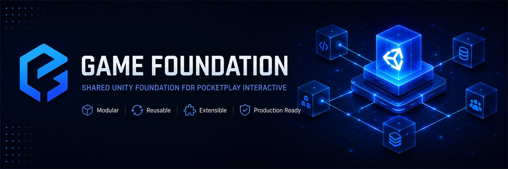
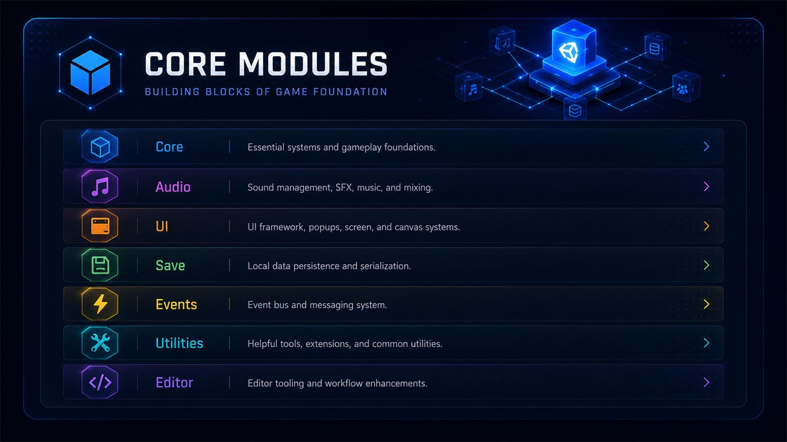
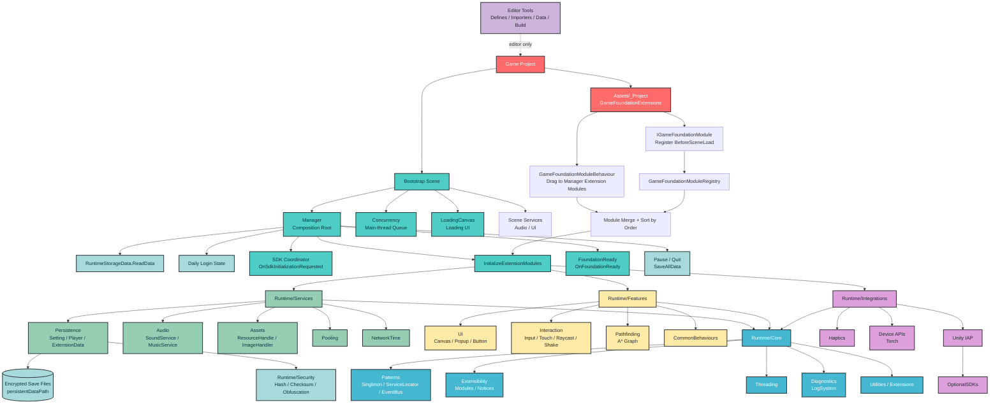
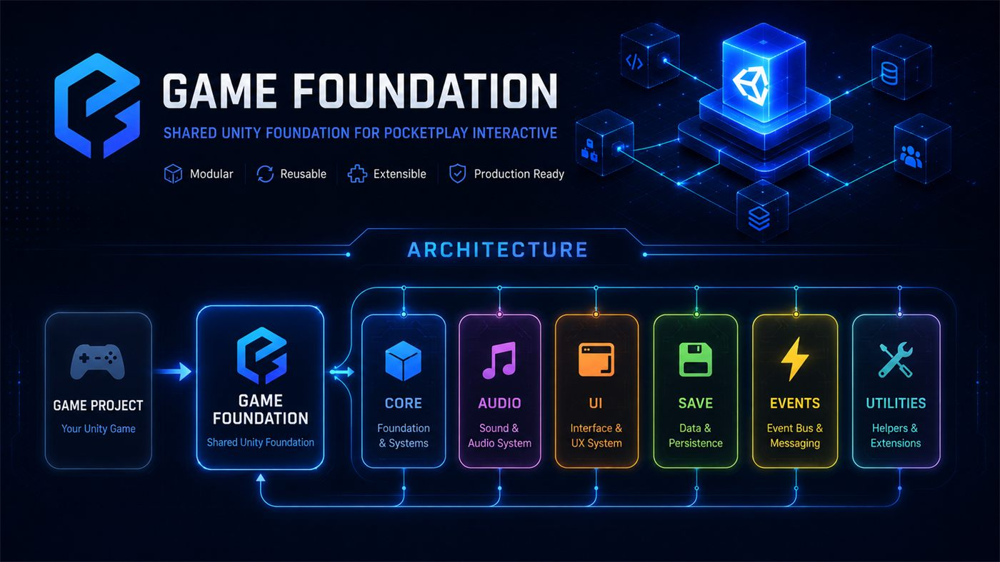
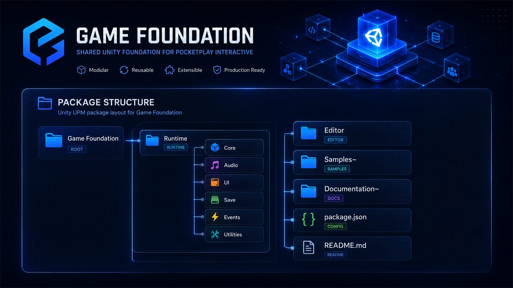

<p align="center">
  
</p>

<h1 align="center">⚡ Game Foundation</h1>

<p align="center">
  <strong>Nền tảng Unity dùng chung cho hệ sinh thái game của PocketPlay Interactive.</strong>
  <br/>
  Tái sử dụng nhanh hơn. Mở rộng sạch hơn. Khởi động dự án mới gọn hơn.
</p>

<p align="center">
  
  
  
  
  
  <a href="CHANGELOG.md"></a>
</p>

---

**Game Foundation** là package nền tảng nội bộ dùng chung cho nhiều Unity project của **PocketPlay Interactive**.

Package gom các phần lặp lại giữa dự án: bootstrap, helper, manager, pattern, save/load, security utilities, SDK wrapper, optional feature và editor tool. Mục tiêu là giảm code copy-paste, chuẩn hóa workflow, dựng project mới nhanh hơn và vẫn giữ khả năng mở rộng theo từng game.

> Một foundation tốt không cố làm game thay bạn. Nó dọn sạch phần lặp lại để team tập trung vào gameplay, content và vận hành.

## Table of Contents

- [Overview](#overview)
- [Core Modules](#core-modules)
- [Architecture](#architecture)
- [Documentation](#documentation)
- [Cấu Trúc](#cấu-trúc)
- [Cài Đặt](#cài-đặt)
- [Tạo Scene Mới](#tạo-scene-mới)
- [Mở Rộng Cho Dự Án Mới](#mở-rộng-cho-dự-án-mới)
- [Scripting Define Symbols](#scripting-define-symbols)
- [Roadmap](#roadmap)
- [Troubleshooting](#troubleshooting)

## Overview

Game Foundation cung cấp một lớp nền dùng lại được cho gameplay, service cấp ứng dụng, integration SDK và tooling trong Unity Editor.

- Giảm lặp code giữa các dự án.
- Chuẩn hóa bootstrap scene, save data, audio, UI và SDK define.
- Cho phép project riêng mở rộng qua module thay vì sửa trực tiếp foundation.
- Giữ SDK tùy chọn sau define để project chưa import SDK vẫn compile được.

Quy ước tên:

| Loại | Tên dùng trong repo |
| --- | --- |
| Tên hiển thị | `Game Foundation` |
| Tên module/API | `GameFoundation` |
| Package ID | `com.dann.gamefoundation` |
| Chủ sở hữu | `PocketPlay Interactive` |

## Core Modules

| Module | Purpose |
| --- | --- |
| Core | Pattern, contract, utility, diagnostics, threading và I/O nền. |
| Services | Save/load, audio, asset loading, pooling và network time. |
| Features | UI, interaction, pathfinding, combat text và common behaviour tùy chọn. |
| Bootstrap | Composition root, loading flow và extension module init qua `Manager`. |
| Integrations | Optional integration cho IAP, haptics và device API. |
| Security | Integrity, memory obfuscation và legacy save compatibility. |
| Editor | Build tool, importer, inspector và data tool cho developer workflow. |
| Libraries | Source vendor giữ riêng khỏi code GameFoundation. |

<p align="center">
  
</p>

## Architecture



Design principles:

- Reusable over duplicated.
- Modular over tightly coupled.
- Practical over overengineered.
- Project-specific code stays in `Assets/_Project`.

<p align="center">
  
</p>

## Documentation

| Guide | Nội dung |
| --- | --- |
| [Documentation Index](Documentation/index.md) | Điểm vào tài liệu package. |
| [Quick Start](Documentation/quick-start.md) | Cài package và tạo scene đầu tiên. |
| [SDK Defines](Documentation/sdk-defines.md) | Define cho Unity IAP tùy chọn. |
| [Samples](Documentation/samples.md) | Cách import và dùng sample scene/code. |

## Cấu Trúc

| Folder | Vai trò |
| --- | --- |
| `Runtime/Core` | Primitive và hạ tầng thấp nhất: pattern, extensibility, threading, I/O và utility. |
| `Runtime/Services` | Capability dùng chung cấp ứng dụng: persistence, audio, asset loading, pooling và network time. |
| `Runtime/Features` | Feature Unity tùy chọn: UI, interaction, pathfinding, combat text và common behaviour. |
| `Runtime/Bootstrap` | Composition root và loading flow của `Manager`. |
| `Runtime/Integrations` | Adapter SDK/native API: IAP, haptics và device API. |
| `Runtime/Security` | Integrity, obfuscation và compatibility với save encryption cũ. |
| `Editor` | Build tool, importer, inspector và data tool chỉ chạy trong Unity Editor. |
| `Libraries` | Source vendor giữ tách biệt khỏi code GameFoundation. |
| `Samples` | Scene và code mẫu, không thuộc runtime production. |

```text
Packages/com.dann.gamefoundation
|-- Runtime
|   |-- Core
|   |   |-- Diagnostics
|   |   |-- Extensibility
|   |   |-- IO
|   |   |-- Patterns
|   |   |-- Threading
|   |   `-- Utilities
|   |-- Services
|   |   |-- Assets
|   |   |-- Audio
|   |   |-- Persistence
|   |   |-- Pooling
|   |   `-- Time
|   |-- Features
|   |   |-- CombatText
|   |   |-- Common
|   |   |-- CommonBehaviours
|   |   |-- Interaction
|   |   |-- Pathfinding
|   |   `-- UI
|   |-- Bootstrap
|   |-- Integrations
|   |   |-- Device
|   |   |-- Haptics
|   |   `-- Purchasing
|   `-- Security
|       |-- Integrity
|       |-- Legacy
|       `-- Obfuscation
|-- Editor
|-- Libraries
|   |-- DOTween
|   |-- EditorCools
|   `-- NiceVibrations
`-- Samples
```

Không đổi tên file, class hoặc public API trong đợt tổ chức folder này. Code cũ tiếp tục gọi API bằng tên hiện có.

Một số tên như `RuntimeStorageExtention` và `EditorCools` là tên legacy đang tồn tại trong code. Tài liệu giữ nguyên tên API/path để người dùng tìm đúng symbol; không rename nếu chưa có migration riêng.

<p align="center">
  
</p>

### Quy Tắc Phân Loại

Không phân loại theo tên class có chữ `Manager` hay không. Phân loại theo trách nhiệm và chiều dependency:

```text
Project / Features
        |
        v
     Services
        |
        v
       Core
```

- `Core` là lớp nền thấp nhất: contract, data structure, pattern, helper thuần, serialization, concurrency và Unity adapter cơ bản. Core không được phụ thuộc ngược vào Services hoặc logic riêng của một game.
- `Services` cung cấp một capability hoàn chỉnh cho gameplay sử dụng, thường có state/cache, truy cập file/network/resource hoặc điều phối nhiều utility. Service có thể là static class, plain C# object hoặc `MonoBehaviour` nếu thực sự cần Unity lifecycle.
- `Integrations` chứa code chạm trực tiếp SDK/package/native API bên ngoài như Unity IAP, haptics hoặc camera torch của từng platform.
- Logic chỉ phục vụ một game, ID sản phẩm, enum âm thanh, event gameplay và config economy phải nằm trong `Assets/_Project`, không nằm trong Core hay Services dùng chung.

Quy tắc dependency mong muốn:

- `Services` được phép phụ thuộc `Core`; `Core` không được gọi ngược lên `Services`.
- Integration nên được bọc sau interface/facade có fallback khi define tắt.
- Bootstrap (`Manager`) là composition root, được phép nối Core, Services và Integrations với nhau; không lấy dependency của `Manager` làm lý do đưa mọi thứ vào Core.

Với project mới, product ID, gameplay event và economy config nên đặt trong `Assets/_Project` hoặc ScriptableObject riêng.

`Runtime/Security/Legacy/HashLib.cs` tồn tại để tương thích save hiện tại. Phần TripleDES/MD5 trong đó là legacy compatibility, không nên dùng làm primitive bảo mật mới.

## Cài Đặt

### Qua Package Manager

1. Mở `Window > Package Manager`.
2. Chọn nút `+` rồi chọn `Add package from git URL...`.
3. Nhập:

```text
git+ssh://git@github.com/PocketPlay-Interactive/_GameFoundation.git
```

Có thể thêm trực tiếp vào `Packages/manifest.json`:

```json
{
  "dependencies": {
    "com.dann.gamefoundation": "git+ssh://git@github.com/PocketPlay-Interactive/_GameFoundation.git#v1.0.0"
  }
}
```

SSH là cách khuyến nghị cho repository private. Nếu máy đã cấu hình Git credential cho GitHub HTTPS, có thể dùng:

```text
https://github.com/PocketPlay-Interactive/_GameFoundation.git#v1.0.0
```

Sau khi Unity resolve package, chọn Game Foundation trong Package Manager để import nội dung ở mục Samples. Giữ toàn bộ `.meta` của package trong Git để GUID asset ổn định.

### Qua Local Package

Trong Package Manager, chọn `Add package from disk...` rồi chọn file `package.json` ở root repository.

Sau khi cài đặt:

1. Tạo scene bootstrap theo mục [Tạo Scene Mới](#tạo-scene-mới).
2. Chỉ bật define cho SDK đã import thật sự.

Package Manager tự resolve các dependency bắt buộc gồm Input System, TextMesh Pro,
UGUI và các Unity built-in module được runtime sử dụng. Unity IAP là integration
tùy chọn; chỉ bật define sau khi package tương ứng đã được cài.

> **Bắt buộc:** Nếu copy source vào `Assets` hoặc Package Manager không resolve
> được dependency, phải cài/kiểm tra thủ công `com.cysharp.unitask`, Input System,
> Newtonsoft JSON, TextMesh Pro và UGUI. Unity built-in modules phải được giữ
> trong Editor đã chọn.

## Tạo Scene Mới

### Checklist Script Mặc Định

Với một scene bootstrap mới, mặc định nên có các script sau:

| Bắt buộc? | Script | Gắn vào GameObject | Lý do |
| --- | --- | --- | --- |
| Bắt buộc | `Manager` | `GameFoundation` hoặc `Manager` | Khởi tạo save, SDK, extension modules, loading state. |
| Bắt buộc | `Concurrency` | `Concurrency` | Chạy callback/coroutine về main thread. Nhiều manager dùng `Concurrency.Instance()`. |
| Nên có | `LoadingCanvas` | `LoadingCanvas` hoặc child UI của `Manager` | UI loading mặc định cho bootstrap. Có thể bỏ trống nếu project tự quản lý loading. |
| Tùy game | `CanvasManager` | `CanvasManager` | Quản lý screen/popup nếu dùng hệ UI có sẵn của foundation. |
| Tùy game | `SoundService` | `SoundService` | Quản lý sound effect dùng chung. |
| Tùy game | `MusicService` | `MusicService` | Quản lý background music dùng chung. |
| Tùy game | `InputManager` | `InputManager` | Dùng input wrapper trong `Runtime/Features/Interaction/Input`. |
| Tùy game | `RaycastSystem` | `RaycastSystem` | Dùng raycast/touch interaction helper. |

Setup tối thiểu:

```text
Scene
|-- GameFoundation
|   `-- Manager
`-- Concurrency
    `-- Concurrency
```

Setup đầy đủ hay dùng cho mobile game:

```text
Scene
|-- GameFoundation
|   |-- Manager
|   `-- LoadingCanvas
|       |-- Canvas
|       `-- CanvasGroup
|-- Concurrency
|   `-- Concurrency
|-- CanvasManager
|   `-- CanvasManager
|-- SoundService
|   `-- SoundService
`-- MusicService
    `-- MusicService
```

Nếu chỉ muốn dùng core helper và save/load, chỉ cần `Manager` + `Concurrency`. Các script còn lại thêm theo tính năng project thực sự dùng.

### Bắt Buộc

Tạo các GameObject sau trong scene đầu tiên:

| GameObject gợi ý | Script cần gắn | Ghi chú |
| --- | --- | --- |
| `GameFoundation` hoặc `Manager` | `Manager` | Bootstrap chính: đọc save, init SDK, init extension modules, quản lý loading. |
| `Concurrency` | `Concurrency` | Cần cho action/coroutine chạy về Unity main thread và delayed action. |

Trên object có script `Manager`:

- Field `Loading Canvas`: kéo object có script `LoadingCanvas` vào nếu dùng UI loading mặc định. Có thể để trống nếu scene không cần loading UI.
- Field `Extension Modules`: kéo các script project riêng kế thừa `GameFoundationModuleBehaviour` vào đây nếu cần init thêm data, remote config, scene service, economy, tutorial, v.v.

### Optional Theo Nhu Cầu

| Khi dùng | GameObject gợi ý | Script cần gắn | Define cần bật |
| --- | --- | --- | --- |
| IAP | Không cần scene object | Gọi qua `InappPurchase.I` | `IAPPURCHASE_ENABLE` |
| Audio dùng chung | `SoundService`, `MusicService` | `SoundService`, `MusicService` | Không cần |
| UI dùng chung | `CanvasManager` | `CanvasManager` | Không cần |

`Manager` hoàn tất bootstrap sau khi khởi tạo các extension module. Callback `OnFoundationReady` chỉ được gọi một lần.

## Mở Rộng Cho Dự Án Mới

Không sửa trực tiếp `Manager` hoặc `RuntimeStorageData` cho logic riêng của từng game nếu có thể tránh được. Đặt code riêng của project vào:

```text
Assets/_Project/GameFoundationExtensions
```

Tạo module mới bằng cách kế thừa `GameFoundationModuleBehaviour`:

```csharp
using System.Collections;
using UnityEngine;

public class ProjectBootstrapModule : GameFoundationModuleBehaviour
{
    public override IEnumerator Initialize()
    {
        Debug.Log("Init project-specific data here");
        yield return null;
    }
}
```

Sau đó gắn script này lên một GameObject trong scene và kéo component đó vào `Manager > Extension Modules`.

Nếu muốn đăng ký bằng code thay vì kéo trên Inspector, dùng `GameFoundationModuleRegistry.Register(...)`. Tham số truyền vào phải là một object implement `IGameFoundationModule`, thường là component kế thừa `GameFoundationModuleBehaviour`.

Ví dụ đăng ký chính component hiện tại:

```csharp
using System.Collections;
using UnityEngine;

public class ProjectBootstrapModule : GameFoundationModuleBehaviour
{
    private void Awake()
    {
        GameFoundationModuleRegistry.Register(this);
    }

    private void OnDestroy()
    {
        GameFoundationModuleRegistry.Unregister(this);
    }

    public override IEnumerator Initialize()
    {
        Debug.Log("Init project-specific data here");
        yield return null;
    }
}
```

`Register(this)` nghĩa là đăng ký chính module này vào danh sách extension modules để `Manager` gọi `Initialize()`. Cách này chỉ cần khi module không tiện kéo vào `Manager > Extension Modules`, ví dụ module được tạo bằng code, nằm trong prefab spawn sớm, hoặc muốn tự bật/tắt module theo điều kiện.

Lưu ý: module phải được register trước khi `Manager` chạy bước init extension modules thì mới được gọi trong lượt bootstrap hiện tại. Với scene setup bình thường, cách dễ nhớ và ít lỗi nhất vẫn là kéo component vào `Manager > Extension Modules`.

### Thêm User Data Riêng Mà Không Sửa GameFoundation

Không thêm field riêng của từng game vào `PlayerSerializable`, `RuntimeStorageData` hoặc file nào trong `Assets/GameFoundation/Runtime`. Nếu cần lưu thêm data người chơi cho một game cụ thể, dùng sẵn `RuntimeStorageData.Player.ExtensionData` rồi bọc lại bằng class riêng trong:

```text
Assets/_Project/GameFoundationExtensions
```

Ví dụ tạo file:

```text
Assets/_Project/GameFoundationExtensions/UserProjectData.cs
```

```csharp
public static class UserProjectData
{
    private const string SkinIdKey = "project.skin_id";
    private const string BestScoreKey = "project.best_score";
    private const string TutorialDoneKey = "project.tutorial_done";

    public static string SkinId
    {
        get => RuntimeStorageData.Player.ExtensionData.Get(SkinIdKey, "default");
        set => RuntimeStorageData.Player.ExtensionData.Set(SkinIdKey, value);
    }

    public static int BestScore
    {
        get => RuntimeStorageData.Player.ExtensionData.GetInt(BestScoreKey, 0);
        set => RuntimeStorageData.Player.ExtensionData.SetInt(BestScoreKey, value);
    }

    public static bool TutorialDone
    {
        get => RuntimeStorageData.Player.ExtensionData.GetBool(TutorialDoneKey, false);
        set => RuntimeStorageData.Player.ExtensionData.SetBool(TutorialDoneKey, value);
    }

    public static void Save()
    {
        RuntimeStorageData.SaveAllData();
    }
}
```

Gameplay chỉ gọi class riêng này, không gọi key string rải rác khắp project:

```csharp
UserProjectData.BestScore = 1200;
UserProjectData.TutorialDone = true;
UserProjectData.Save();
```

#### Lưu Một Object Bằng JSON

`ExtensionData` chỉ lưu trực tiếp `string`, `int`, `float` và `bool`. Muốn lưu một object, serialize object thành JSON string, lưu string đó bằng `ExtensionData.Set`, rồi deserialize khi đọc.

Ví dụ model riêng của project:

```csharp
using System;
using System.Collections.Generic;

[Serializable]
public class InventorySaveData
{
    public int version = 1;
    public int coins;
    public List<string> ownedSkinIds = new List<string>();
}
```

Bọc toàn bộ key và logic JSON trong `UserProjectData`, không serialize rải rác ở gameplay:

```csharp
using UnityEngine;

public static class UserProjectData
{
    private const string InventoryKey = "project.inventory";

    public static InventorySaveData LoadInventory()
    {
        string json = RuntimeStorageData.Player.ExtensionData.Get(InventoryKey);

        if (string.IsNullOrEmpty(json))
            return new InventorySaveData();

        try
        {
            InventorySaveData data =
                JsonUtility.FromJson<InventorySaveData>(json);

            return data ?? new InventorySaveData();
        }
        catch (System.Exception exception)
        {
            Debug.LogWarning(
                $"Could not read inventory data: {exception.Message}");
            return new InventorySaveData();
        }
    }

    public static void SaveInventory(InventorySaveData data)
    {
        if (data == null)
            return;

        string json = JsonUtility.ToJson(data);
        RuntimeStorageData.Player.ExtensionData.Set(InventoryKey, json);
        RuntimeStorageData.SaveAllData();
    }
}
```

Gameplay sử dụng object bình thường và chỉ gọi wrapper để load/save:

```csharp
InventorySaveData inventory = UserProjectData.LoadInventory();
inventory.coins += 100;
inventory.ownedSkinIds.Add("skin_red");
UserProjectData.SaveInventory(inventory);
```

Luồng dữ liệu thực tế:

```text
InventorySaveData
    -> JsonUtility.ToJson
    -> ExtensionData.Set("project.inventory", json)
    -> RuntimeStorageData.SaveAllData
    -> file player save đã được bảo vệ bởi GameFoundation
```

JSON này là một string nằm bên trong player save, không phải file `.json` riêng trong `Application.persistentDataPath`.
Không cần tự mã hóa hoặc Base64 JSON trước khi gọi `Set`; `ExtensionData` và runtime storage sẽ xử lý lớp bảo vệ save hiện có.

Giới hạn của `JsonUtility`:

- Class cần có `[Serializable]`.
- Dữ liệu cần lưu phải là field; property không được serialize.
- `List<T>` và array được hỗ trợ. `Dictionary<TKey, TValue>` không được hỗ trợ trực tiếp; chuyển dictionary thành một list entry có `key` và `value`.
- Hạn chế dùng interface hoặc kiểu đa hình trong save model.
- Nên có field `version` để migrate khi cấu trúc object thay đổi.

Chỉ gọi wrapper sau khi `Manager.Awake()` đã chạy `RuntimeStorageData.ReadData()`. Với flow mặc định, có thể load default và migrate object trong một `GameFoundationModuleBehaviour`, vì extension modules được khởi tạo sau khi player save đã được đọc.

Với object nhỏ và luôn thay đổi cùng nhau, lưu một JSON blob là đủ. Với data lớn hoặc các phần có vòng đời khác nhau, chia thành nhiều key như `project.inventory`, `project.progress`, `project.settings` để tránh phải serialize lại toàn bộ data mỗi lần.

Nếu data cần init default hoặc migrate khi mở game, tạo thêm module trong `_Project`:

```csharp
using System.Collections;

public class ProjectUserDataModule : GameFoundationModuleBehaviour
{
    public override IEnumerator Initialize()
    {
        if (string.IsNullOrEmpty(UserProjectData.SkinId))
            UserProjectData.SkinId = "default";

        yield return null;
    }
}
```

Sau đó gắn `ProjectUserDataModule` lên một GameObject trong scene và kéo vào `Manager > Extension Modules`.

Quy tắc cho user data riêng:

- Key nên có prefix riêng của project, ví dụ `project.best_score`, `project.skin_id`, để tránh trùng key với module khác.
- Data đơn giản dùng `ExtensionData.Set`, `SetInt`, `SetFloat`, `SetBool` và các hàm `Get` tương ứng.
- Sau khi đổi data quan trọng, gọi `RuntimeStorageData.SaveAllData()` hoặc bọc qua hàm `UserProjectData.Save()`.
- Nếu data phức tạp, nhiều field hoặc cần migration rõ ràng, vẫn đặt code trong `_Project` và serialize thành string/json rồi lưu qua `ExtensionData.Set`.
- Chỉ sửa model gốc trong `GameFoundation` khi data đó thật sự là tính năng dùng chung cho mọi game.

Quy tắc:

- Primitive và hạ tầng dùng chung đặt trong `GameFoundation/Runtime/Core`.
- Capability cấp ứng dụng đặt trong `GameFoundation/Runtime/Services`.
- Component gameplay/UI tùy chọn đặt trong `GameFoundation/Runtime/Features`.
- Thứ nào chỉ của một game đặt trong `Assets/_Project/GameFoundationExtensions`.
- Source vendor không chỉnh sửa đặt trong `GameFoundation/Libraries`.
- Public API mà gameplay gọi nên có fallback/no-op khi define tắt.
- Config của từng game như ad unit id, product id, economy, level, remote flag nên nằm trong ScriptableObject hoặc folder `_Project`, không hard-code vào foundation.
- Khi phân phối qua UPM, phải commit toàn bộ `.meta` để giữ GUID asset ổn định.

## Scripting Define Symbols

Có thể bật/tắt define bằng editor window:

```text
Unity menu > GameFoundation > Configuration > SDK Defines
```

Window này đọc define của selected build target hiện tại, cho tick/bỏ tick các define tùy chọn, rồi bấm `Apply Defines` để lưu.

Nếu muốn chỉnh tay, vào `Project Settings > Player > Other Settings > Scripting Define Symbols`, thêm symbol theo SDK đang dùng.

| Define | Dùng khi |
| --- | --- |
| `IAPPURCHASE_ENABLE` | Đã import Unity IAP. |

Chỉ bật `IAPPURCHASE_ENABLE` sau khi đã import Unity IAP.

## Core

Code nền nằm trong `Runtime/Core`. Nhóm này không chứa SDK, gameplay feature hay state cấp ứng dụng.

### Singleton

```csharp
public class GameManager : SingletonGlobal<GameManager>
{
    public void Init() { }
}

GameManager.I.Init();
```

```csharp
public class InventoryService : GenericSingleton<InventoryService>
{
}

InventoryService.I.ToString();
```

### Concurrency

`Concurrency` dùng để enqueue action/coroutine về Unity main thread.

```csharp
Concurrency.Instance().Enqueue(() =>
{
    Debug.Log("Run on main thread next frame");
});

Concurrency.Instance().Enqueue(MyCoroutine(), 0.5f);
```

Scene phải có object gắn script `Concurrency` trước khi gọi `Concurrency.Instance()`.

## Services

Các service nằm trong `Runtime/Services` và cung cấp API cấp ứng dụng cho gameplay:

| Folder | Trách nhiệm |
| --- | --- |
| `Assets` | Load/cache Unity resource và download image. |
| `Audio` | Music, sound effect và audio UI adapter. |
| `Persistence` | Player/setting model, runtime save và PlayerPrefs wrapper. |
| `Pooling` | Facade pool prefab dùng chung. |
| `Time` | Lấy network time và cache thời gian gần nhất. |

### Runtime Storage Và Save

`RuntimeStorageData` đọc/ghi `SettingSerializable` và `PlayerSerializable`.

```csharp
RuntimeStorageData.ReadData();
RuntimeStorageData.Player.ExtensionData.SetInt("score", 1234);
RuntimeStorageData.SaveAllData();
```

Với dự án mới, nếu cần data riêng, ưu tiên tạo wrapper trong `Assets/_Project/GameFoundationExtensions` dùng `PlayerSerializable.ExtensionData`. Xem mục [Thêm User Data Riêng Mà Không Sửa GameFoundation](#thêm-user-data-riêng-mà-không-sửa-gamefoundation) trước khi sửa model gốc.

#### RuntimeStorageExtension

`RuntimeStorageExtension` là API rút gọn để lưu và đọc data riêng của project qua `Player.ExtensionData`. API hỗ trợ trực tiếp `string`, `int`, `float`, `bool`; các kiểu còn lại được serialize bằng `JsonUtility`.

`RuntimeStorageExtention` vẫn tồn tại như alias legacy để code cũ không gãy.

```csharp
RuntimeStorageExtension.Set("project.best_score", 1200);
int bestScore = RuntimeStorageExtension.Int("project.best_score");

RuntimeStorageExtension.Set("project.inventory", inventoryData);
InventorySaveData inventory =
    RuntimeStorageExtension.Object<InventorySaveData>("project.inventory");

bool hasInventory = RuntimeStorageExtension.Has("project.inventory");
```

`Set<T>` tự gọi `RuntimeStorageData.SaveAllData()` sau khi cập nhật. Với object, class phải tương thích với `JsonUtility`, có constructor không tham số và được đánh dấu `[Serializable]`; nếu key không tồn tại hoặc JSON không hợp lệ, `Object<T>` trả về default value. Chỉ gọi API sau khi `RuntimeStorageData.ReadData()` đã khởi tạo player data.

### Time/NetworkTime

`NetworkTime` lấy thời gian UTC từ network, cache lần lấy thành công gần nhất trong `RuntimeStorageData.Player.ExtensionData`, rồi trả kết quả đã đổi sang múi giờ local của thiết bị.

Yêu cầu:

- `RuntimeStorageData.ReadData()` đã chạy. Trong scene bootstrap mặc định, `Manager.Awake()` thực hiện bước này.
- Thiết bị cần network để lấy thời gian mới. Khi request lỗi, service dùng thời gian cache; nếu chưa có cache hợp lệ thì dùng `DateTime.UtcNow` của thiết bị.

Cách dùng:

```csharp
using System;
using System.Threading.Tasks;
using UnityEngine;

public class DailyRewardController : MonoBehaviour
{
    private async void Start()
    {
        DateTime localTime = await NetworkTime.GetTimeAsync();
        Debug.Log($"Current local time: {localTime:o}");
    }
}
```

`GetTimeAsync()` bắt lỗi network, log warning và trả về thời gian fallback thay vì đẩy lỗi network ra caller.

#### Cache Và Save

Cache dùng key `NetworkTime_UTC` trong `Player.ExtensionData` và lưu UTC theo định dạng round-trip (`"o"`). Khi lấy giờ mạng thành công, `NetworkTime` chỉ cập nhật cache trong runtime, không tự gọi `RuntimeStorageData.SaveAllData()`.

`Manager` mặc định save khi application pause hoặc quit. Nếu project cần ghi cache xuống disk ngay lập tức:

```csharp
await NetworkTime.GetTimeAsync();
RuntimeStorageData.SaveAllData();
```

#### Giá Trị Trả Về

Method trả `DateTime` đã cộng offset local hiện tại của thiết bị và có `DateTimeKind.Unspecified`. Nếu gameplay cần so sánh deadline tuyệt đối giữa các múi giờ, project nên chuẩn hóa quy ước UTC riêng thay vì dựa vào `DateTime.Kind` của giá trị trả về.

Network time giúp giảm phụ thuộc vào đồng hồ thiết bị nhưng cache local vẫn chỉ là fallback. Không dùng service này làm nguồn xác thực duy nhất cho economy hoặc giao dịch có giá trị; quyết định quan trọng nên được kiểm tra ở server.

## Features

Feature Unity tùy chọn nằm trong `Runtime/Features`. Chỉ đưa feature thực sự dùng vào scene/project:

- `UI`: screen, popup, button guard và shader UI dùng chung.
- `Interaction`: input, touch, shake và raycast system.
- `Pathfinding`: A* graph/pathfinding component và editor tool đi kèm.
- `CombatText`: floating damage prefab/component.
- `CommonBehaviours`: các `MonoBehaviour` tiện dụng cho move, rotation, popup và reset state.

### Raycast Listener

Gắn `RaycastSystem` vào scene, sau đó component nhận event implement `IRaycastEventsListener` và tự register theo lifecycle:

```csharp
using UnityEngine;

public class MyRaycastHandler : MonoBehaviour, IRaycastEventsListener
{
    private void OnEnable() => RaycastSystem.RegisterListener(this);
    private void OnDisable() => RaycastSystem.UnregisterListener(this);

    public void OnRaycast3DBegan(RaycastHit hit) { }
    public void OnRaycast2DBegan(RaycastHit2D hit) { }
    public void OnRaycastBeganPosition(Vector2 position) { }
    public void OnRaycastDrag(Vector2 position) { }
    public void OnRaycastEnded(Vector2 position) { }
}
```

## Integrations

Các integration hiện có nằm trong `Runtime/Integrations`:

| Folder | Chức năng |
| --- | --- |
| `Runtime/Integrations/Purchasing/UnityIAP` | Unity In-App Purchasing. |
| `Runtime/Integrations/Device/Torch` | Android/iOS torch native bridge. |
| `Haptics` | Facade gọi haptic provider. |

### In-App Purchase

```text
IAPPURCHASE_ENABLE
```

Chỉ bật define này sau khi đã import Unity IAP. Product list nên để trong asset/project config riêng của game.

### Torch Trên Android

Nếu project dùng `Torch`, Android manifest cần khai báo camera/flash:

```xml
<uses-permission android:name="android.permission.CAMERA" />
<uses-feature android:name="android.hardware.camera" android:required="false" />
<uses-feature android:name="android.hardware.camera.flash" android:required="false" />
```

## Security

Security runtime nằm trong `Runtime/Security`:

- `Integrity`: checksum và kiểm tra dữ liệu bị thay đổi.
- `Obfuscation`: che giấu value trong memory; đây không phải encryption chống attacker có chủ đích.
- `Legacy`: thuật toán giữ lại để đọc/ghi save format hiện tại. Không dùng làm API bảo mật mới.

```csharp
int key = MemoryObfuscation.GenerateKey();
int encrypted = MemoryObfuscation.EncryptInt(100, key);
int value = MemoryObfuscation.DecryptInt(encrypted, key);

int checksum = MemoryChecksum.GenerateChecksum(value);
bool valid = MemoryChecksum.VerifyChecksum(value, checksum);
```

`MemoryChecksum` dùng device-bound HMAC cho value mới và vẫn chấp nhận legacy checksum khi đọc save cũ.

## Libraries

Source nguyên bản của DOTween, EditorCools và NiceVibrations nằm trong `Libraries`. Không đặt code GameFoundation hoặc code project vào đây; khi update vendor nên thay nguyên package và kiểm tra lại integration tương ứng.

Các thành phần trong `Libraries` giữ license và điều khoản phân phối riêng. Xem
`Library Notices.md` trước khi public hoặc phân phối repository cho bên khác.

Editor tool nằm trong `Editor`, tách khỏi runtime build. Scene/code demo của inspector helper nằm trong `Samples`.

## Roadmap

- [x] UPM package structure.
- [x] Bootstrap scene flow với `Manager` và extension modules.
- [x] Save/load foundation qua `RuntimeStorageData` và `ExtensionData`.
- [x] Optional SDK integrations qua scripting define symbols.
- [x] Tài liệu chi tiết cho từng module lớn.
- [x] Sample scene chuẩn cho bootstrap, save, UI và integration flow.
- [x] Test coverage cho các service cốt lõi.

## Kiểm Tra Sau Khi Import

1. Mở Unity và đợi reimport xong.
2. Kiểm tra Console không có compile error.
3. Kiểm tra scene đầu tiên có object `Manager` và `Concurrency`.
4. Nếu dùng loading mặc định, `Manager.Loading Canvas` phải trỏ tới object có script `LoadingCanvas`.
5. Nếu bật define SDK, đảm bảo SDK đã import trước.
6. Regenerate `.csproj` từ Unity nếu IDE vẫn đọc path cũ.

## Troubleshooting

### Mất reference prefab/script sau khi rename hoặc move

Nếu import `GameFoundation` như source shared không kèm `.meta`, Unity sẽ tự sinh GUID mới cho từng project. Hạn chế để prefab/scene trong foundation reference trực tiếp tới asset ngoài foundation; nếu cần prefab dùng chung ổn định GUID thì nên đóng gói thành Unity package riêng và quản lý `.meta` theo package đó.
