<p align="center">
  
</p>

<h1 align="center">? Game Foundation</h1>

<p align="center">
  <strong>N?n t?ng Unity dùng chung cho h? sinh thái game c?a PocketPlay Interactive.</strong>
  <br/>
  Tái s? d?ng nhanh hon. M? r?ng s?ch hon. Kh?i d?ng d? án m?i g?n hon.
</p>

<p align="center">
  
  
  
  
  
  <a href="CHANGELOG.md"></a>
</p>

---

**Game Foundation** là package n?n t?ng n?i b? dùng chung cho nhi?u Unity project c?a **PocketPlay Interactive**.

Package gom các ph?n l?p l?i gi?a d? án: bootstrap, helper, manager, pattern, save/load, security utilities, SDK wrapper, optional feature và editor tool. M?c tiêu là gi?m code copy-paste, chu?n hóa workflow, d?ng project m?i nhanh hon và v?n gi? kh? nang m? r?ng theo t?ng game.

> M?t foundation t?t không c? làm game thay b?n. Nó d?n s?ch ph?n l?p l?i d? team t?p trung vào gameplay, content và v?n hành.

## Table of Contents

- [Overview](#overview)
- [Core Modules](#core-modules)
- [Architecture](#architecture)
- [Documentation](#documentation)
- [C?u Trúc](#c?u-trúc)
- [Cài Ð?t](#cài-d?t)
- [T?o Scene M?i](#t?o-scene-m?i)
- [M? R?ng Cho D? Án M?i](#m?-r?ng-cho-d?-án-m?i)
- [Scripting Define Symbols](#scripting-define-symbols)
- [Roadmap](#roadmap)
- [Troubleshooting](#troubleshooting)

## Overview

Game Foundation cung c?p m?t l?p n?n dùng l?i du?c cho gameplay, service c?p ?ng d?ng, integration SDK và tooling trong Unity Editor.

- Gi?m l?p code gi?a các d? án.
- Chu?n hóa bootstrap scene, save data, audio, UI và SDK define.
- Cho phép project riêng m? r?ng qua module thay vì s?a tr?c ti?p foundation.
- Gi? SDK tùy ch?n sau define d? project chua import SDK v?n compile du?c.

Quy u?c tên:

| Lo?i | Tên dùng trong repo |
| --- | --- |
| Tên hi?n th? | `Game Foundation` |
| Tên module/API | `GameFoundation` |
| Package ID | `com.dann.gamefoundation` |
| Ch? s? h?u | `PocketPlay Interactive` |

## Core Modules

| Module | Purpose |
| --- | --- |
| Core | Pattern, contract, utility, diagnostics, threading và I/O n?n. |
| Services | Save/load, audio, asset loading, pooling và network time. |
| Features | UI, interaction, pathfinding, combat text và common behaviour tùy ch?n. |
| Bootstrap | Composition root, loading flow và extension module init qua `Manager`. |
| Integrations | SDK/native adapter nhu IAP, haptics, device API, ads và analytics. |
| Security | Integrity, memory obfuscation và legacy save compatibility. |
| Editor | Build tool, importer, inspector và data tool cho developer workflow. |
| Libraries | Source vendor gi? riêng kh?i code GameFoundation. |

<p align="center">
  
</p>

## Architecture

```mermaid
flowchart TD
    Project[Game Project] --> Scene[Bootstrap Scene]
    Project --> ProjectExt[Assets/_Project<br/>GameFoundationExtensions]

    Scene --> Manager[Manager<br/>Composition Root]
    Scene --> Concurrency[Concurrency<br/>Main-thread Queue]
    Scene --> Loading[LoadingCanvas<br/>Loading UI]
    Scene --> OptionalSceneServices[Scene Services<br/>Audio / Ads / Analytics / UI]

    Manager --> ReadSave[RuntimeStorageData.ReadData]
    Manager --> LoginState[Daily Login State]
    Manager --> SdkCoordinator[SDK Coordinator<br/>OnSdkInitializationRequested]
    Manager --> ModuleInit[InitializeExtensionModules]
    Manager --> Finalize[FinalizeAdSequence<br/>OnFoundationReady]
    Manager --> PauseQuit[Pause / Quit<br/>SaveAllData]

    ProjectExt --> MonoModules[GameFoundationModuleBehaviour<br/>Drag to Manager Extension Modules]
    ProjectExt --> RuntimeModules[IGameFoundationModule<br/>Register BeforeSceneLoad]
    MonoModules --> ModuleRegistryMerge[Module Merge + Sort by Order]
    RuntimeModules --> Registry[GameFoundationModuleRegistry]
    Registry --> ModuleRegistryMerge
    ModuleRegistryMerge --> ModuleInit

    ModuleInit --> Services[Runtime/Services]
    ModuleInit --> Integrations[Runtime/Integrations]
    ModuleInit --> Analytics[AnalyticsService]
    ModuleInit --> Advertising[AdvertisingService]
    ModuleInit --> Features[Runtime/Features]

    Services --> Persistence[Persistence<br/>Setting / Player / ExtensionData]
    Services --> Audio[Audio<br/>SoundService / MusicService]
    Services --> AssetsService[Assets<br/>ResourceHandle / ImageHandler]
    Services --> Pooling[Pooling]
    Services --> NetworkTime[NetworkTime]

    Features --> UI[UI<br/>Canvas / Popup / Button]
    Features --> Interaction[Interaction<br/>Input / Touch / Raycast / Shake]
    Features --> Pathfinding[Pathfinding<br/>A* Graph]
    Features --> CommonBehaviours[CommonBehaviours]

    Integrations --> IAP[Unity IAP]
    Integrations --> Haptics[Haptics]
    Integrations --> Device[Device APIs<br/>Torch]
    Analytics --> AnalyticsProviders[Firebase / AppsFlyer Providers]
    Advertising --> AdControllers[Ad Controllers<br/>Banner / Interstitial / Rewarded / AppOpen]
    AdControllers --> AdProviders[AdMob / Custom Providers]

    Persistence --> SaveFiles[(Encrypted Save Files<br/>persistentDataPath)]
    Persistence --> Security[Runtime/Security<br/>Hash / Checksum / Obfuscation]
    AnalyticsProviders --> OptionalSDKs[Optional SDKs<br/>via Define Symbols]
    AdProviders --> OptionalSDKs
    IAP --> OptionalSDKs

    Services --> Core[Runtime/Core]
    Features --> Core
    Integrations --> Core
    Analytics --> Core
    Advertising --> Core
    Editor[Editor Tools<br/>Defines / Importers / Data / Build] -. editor only .-> Project

    Core --> Patterns[Patterns<br/>Singleton / ServiceLocator / EventBus]
    Core --> Extensibility[Extensibility<br/>Modules / Notices]
    Core --> Threading[Threading]
    Core --> Diagnostics[Diagnostics<br/>LogSystem]
    Core --> Utilities[Utilities / Extensions]

    classDef project fill:#FF6B6B,stroke:#24292f,stroke-width:2px,color:#fff
    classDef bootstrap fill:#4ECDC4,stroke:#24292f,stroke-width:2px,color:#073642
    classDef core fill:#45B7D1,stroke:#24292f,stroke-width:2px,color:#fff
    classDef services fill:#96CEB4,stroke:#24292f,stroke-width:2px,color:#073642
    classDef features fill:#FFEAA7,stroke:#24292f,stroke-width:2px,color:#24292f
    classDef integrations fill:#DDA0DD,stroke:#24292f,stroke-width:2px,color:#24292f
    classDef data fill:#A8DADC,stroke:#24292f,stroke-width:2px,color:#073642
    classDef editor fill:#CDB4DB,stroke:#24292f,stroke-width:2px,color:#24292f

    class Project,ProjectExt project
    class Scene,Manager,Concurrency,Loading,SdkCoordinator,ModuleInit,Finalize bootstrap
    class Core,Patterns,Extensibility,Threading,Diagnostics,Utilities core
    class Services,Persistence,Audio,AssetsService,Pooling,NetworkTime services
    class Features,UI,Interaction,Pathfinding,CommonBehaviours features
    class Integrations,IAP,Haptics,Device,Analytics,Advertising,AnalyticsProviders,AdControllers,AdProviders,OptionalSDKs integrations
    class SaveFiles,Security,ReadSave,LoginState,PauseQuit data
    class Editor editor
```



Design principles:

- Reusable over duplicated.
- Modular over tightly coupled.
- Practical over overengineered.
- Project-specific code stays in `Assets/_Project`.

<p align="center">
  
</p>

## Documentation

| Guide | N?i dung |
| --- | --- |
| [Documentation Index](Documentation/index.md) | Ði?m vào tài li?u package. |
| [Quick Start](Documentation/quick-start.md) | Cài package và t?o scene d?u tiên. |
| [SDK Defines](Documentation/sdk-defines.md) | Define cho Firebase, AdMob, AppsFlyer, IAP và plugin tùy ch?n. |
| [Samples](Documentation/samples.md) | Cách import và dùng sample scene/code. |

## C?u Trúc

| Folder | Vai trò |
| --- | --- |
| `Runtime/Core` | Primitive và h? t?ng th?p nh?t: pattern, extensibility, threading, I/O và utility. |
| `Runtime/Services` | Capability dùng chung c?p ?ng d?ng: persistence, audio, asset loading, pooling và network time. |
| `Runtime/Features` | Feature Unity tùy ch?n: UI, interaction, pathfinding, combat text và common behaviour. |
| `Runtime/Bootstrap` | Composition root và loading flow c?a `Manager`. |
| `Advertising` | AdMob và native ad adapter, du?c compile vào runtime assembly qua asmref. |
| `Analytics` | Firebase và AppsFlyer analytics adapter, d?t ? package root. |
| `Runtime/Integrations` | Adapter SDK/native API: IAP, haptics và device API. |
| `Runtime/Security` | Integrity, obfuscation và compatibility v?i save encryption cu. |
| `Editor` | Build tool, importer, inspector và data tool ch? ch?y trong Unity Editor. |
| `Libraries` | Source vendor gi? tách bi?t kh?i code GameFoundation. |
| `Samples` | Scene và code m?u, không thu?c runtime production. |

```text
Packages/com.dann.gamefoundation
|-- Runtime
|   |-- Core
|   |   |-- Diagnostics
|   |   |-- Extensibility
|   |   |-- IO
|   |   |-- Patterns
|   |   |-- Threading
|   |   `-- Utilities
|   |-- Services
|   |   |-- Assets
|   |   |-- Audio
|   |   |-- Persistence
|   |   |-- Pooling
|   |   `-- Time
|   |-- Features
|   |   |-- CombatText
|   |   |-- Common
|   |   |-- CommonBehaviours
|   |   |-- Interaction
|   |   |-- Pathfinding
|   |   `-- UI
|   |-- Bootstrap
|   |-- Integrations
|   |   |-- Device
|   |   |-- Haptics
|   |   `-- Purchasing
|   `-- Security
|       |-- Integrity
|       |-- Legacy
|       `-- Obfuscation
|-- Advertising
|   |-- GoogleMobileAds
|   `-- JKit
|-- Analytics
|   |-- AppsFlyer
|   `-- Firebases
|-- Editor
|-- Libraries
|   |-- DOTween
|   |-- EditorCools
|   `-- NiceVibrations
`-- Samples
```

Không d?i tên file, class ho?c public API trong d?t t? ch?c folder này. Code cu ti?p t?c g?i API b?ng tên hi?n có.

M?t s? tên nhu `RuntimeStorageExtention`, `AdmobInterstitalOpen`, `AdMobInterstital`, `AdmobNativeCollap`, `Firebases` và `EditorCools` là tên legacy dang t?n t?i trong code. Tài li?u gi? nguyên tên API/path d? ngu?i dùng tìm dúng symbol; không rename n?u chua có migration riêng.

<p align="center">
  
</p>

### Quy T?c Phân Lo?i

Không phân lo?i theo tên class có ch? `Manager` hay không. Phân lo?i theo trách nhi?m và chi?u dependency:

```text
Project / Features
        |
        v
     Services
        |
        v
       Core
```

- `Core` là l?p n?n th?p nh?t: contract, data structure, pattern, helper thu?n, serialization, concurrency và Unity adapter co b?n. Core không du?c ph? thu?c ngu?c vào Services ho?c logic riêng c?a m?t game.
- `Services` cung c?p m?t capability hoàn ch?nh cho gameplay s? d?ng, thu?ng có state/cache, truy c?p file/network/resource ho?c di?u ph?i nhi?u utility. Service có th? là static class, plain C# object ho?c `MonoBehaviour` n?u th?c s? c?n Unity lifecycle.
- `Integrations` ch?a code ch?m tr?c ti?p SDK/package/native API bên ngoài nhu AdMob, Firebase, Unity IAP ho?c camera torch c?a t?ng platform.
- Logic ch? ph?c v? m?t game, ID s?n ph?m, enum âm thanh, event gameplay và config economy ph?i n?m trong `Assets/_Project`, không n?m trong Core hay Services dùng chung.

Quy t?c dependency mong mu?n:

- `Services` du?c phép ph? thu?c `Core`; `Core` không du?c g?i ngu?c lên `Services`.
- Integration nên du?c b?c sau interface/facade có fallback khi define t?t.
- Bootstrap (`Manager`) là composition root, du?c phép n?i Core, Services và Integrations v?i nhau; không l?y dependency c?a `Manager` làm lý do dua m?i th? vào Core.

V?i project m?i, product ID, gameplay event và economy config nên d?t trong `Assets/_Project` ho?c ScriptableObject riêng.

`Runtime/Security/Legacy/HashLib.cs` t?n t?i d? tuong thích save hi?n t?i. Ph?n TripleDES/MD5 trong dó là legacy compatibility, không nên dùng làm primitive b?o m?t m?i.

## Cài Ð?t

### Qua Package Manager

1. M? `Window > Package Manager`.
2. Ch?n nút `+` r?i ch?n `Add package from git URL...`.
3. Nh?p:

```text
git+ssh://git@github.com/PocketPlay-Interactive/_GameFoundation.git
```

Có th? thêm tr?c ti?p vào `Packages/manifest.json`:

```json
{
  "dependencies": {
    "com.dann.gamefoundation": "git+ssh://git@github.com/PocketPlay-Interactive/_GameFoundation.git#v1.0.22",
    "com.cysharp.unitask": "https://github.com/Cysharp/UniTask.git?path=src/UniTask/Assets/Plugins/UniTask"
  }
}
```

`UniTask` is intentionally a direct project dependency. Unity does not accept a Git URL as a dependency value inside a package's own `package.json`.

SSH là cách khuy?n ngh? cho repository private. N?u máy dã c?u hình Git credential cho GitHub HTTPS, có th? dùng:

```text
https://github.com/PocketPlay-Interactive/_GameFoundation.git#v1.0.0
```

Sau khi Unity resolve package, ch?n Game Foundation trong Package Manager d? import n?i dung ? m?c Samples. Gi? toàn b? `.meta` c?a package trong Git d? GUID asset ?n d?nh.

### Qua Local Package

Trong Package Manager, ch?n `Add package from disk...` r?i ch?n file `package.json` ? root repository.

Sau khi cài d?t:

1. T?o scene bootstrap theo m?c [T?o Scene M?i](#t?o-scene-m?i).
2. Ch? b?t define cho SDK dã import th?t s?.

Package Manager t? resolve các dependency b?t bu?c g?m Input System, TextMesh Pro,
UGUI và các Unity built-in module du?c runtime s? d?ng. Firebase, Google Mobile
Ads, AppsFlyer, Unity IAP và JKit v?n là integration tùy ch?n; ch? b?t define
tuong ?ng sau khi SDK dó dã du?c cài.

## T?o Scene M?i

### Checklist Script M?c Ð?nh

V?i m?t scene bootstrap m?i, m?c d?nh nên có các script sau:

| B?t bu?c? | Script | G?n vào GameObject | Lý do |
| --- | --- | --- | --- |
| B?t bu?c | `Manager` | `GameFoundation` ho?c `Manager` | Kh?i t?o save, SDK, extension modules, loading state. |
| B?t bu?c | `Concurrency` | `Concurrency` | Ch?y callback/coroutine v? main thread. Nhi?u manager dùng `Concurrency.Instance()`. |
| Nên có | `LoadingCanvas` | `LoadingCanvas` ho?c child UI c?a `Manager` | UI loading m?c d?nh cho bootstrap. Có th? b? tr?ng n?u project t? qu?n lý loading. |
| Tùy game | `CanvasManager` | `CanvasManager` | Qu?n lý screen/popup n?u dùng h? UI có s?n c?a foundation. |
| Tùy game | `SoundService` | `SoundService` | Qu?n lý sound effect dùng chung. |
| Tùy game | `MusicService` | `MusicService` | Qu?n lý background music dùng chung. |
| Tùy game | `InputManager` | `InputManager` | Dùng input wrapper trong `Runtime/Features/Interaction/Input`. |
| Tùy game | `RaycastSystem` | `RaycastSystem` | Dùng raycast/touch interaction helper. |

Setup t?i thi?u không ads/Firebase:

```text
Scene
|-- GameFoundation
|   `-- Manager
`-- Concurrency
    `-- Concurrency
```

Setup d?y d? hay dùng cho mobile game:

```text
Scene
|-- GameFoundation
|   |-- Manager
|   `-- LoadingCanvas
|       |-- Canvas
|       `-- CanvasGroup
|-- Concurrency
|   `-- Concurrency
|-- CanvasManager
|   `-- CanvasManager
|-- SoundService
|   `-- SoundService
|-- MusicService
|   `-- MusicService
|-- Analytics
|   `-- AnalyticsService         # Provider prefabs: Firebase / AppsFlyer
`-- Advertising
    |-- AdvertisingService       # N?u b?t ADMOB ho?c provider ads khác
    |-- BannerAdvertisingController
    |-- InterstitialAdvertisingController
    |-- RewardedVideoAdvertisingController
    `-- AppOpenAdvertisingController
```

N?u ch? mu?n dùng core helper và save/load, ch? c?n `Manager` + `Concurrency`. Các script còn l?i thêm theo tính nang project th?c s? dùng.

### B?t Bu?c

T?o các GameObject sau trong scene d?u tiên:

| GameObject g?i ý | Script c?n g?n | Ghi chú |
| --- | --- | --- |
| `GameFoundation` ho?c `Manager` | `Manager` | Bootstrap chính: d?c save, init SDK, init extension modules, qu?n lý loading. |
| `Concurrency` | `Concurrency` | C?n cho action/coroutine ch?y v? Unity main thread. Nhi?u flow ads, callback, delayed action ph? thu?c object này. |

Trên object có script `Manager`:

- Field `Loading Canvas`: kéo object có script `LoadingCanvas` vào n?u dùng UI loading m?c d?nh. Có th? d? tr?ng n?u scene không c?n loading UI.
- Field `Extension Modules`: kéo các script project riêng k? th?a `GameFoundationModuleBehaviour` vào dây n?u c?n init thêm data, remote config, scene service, economy, tutorial, v.v.

### Optional Theo Nhu C?u

| Khi dùng | GameObject g?i ý | Script c?n g?n | Define c?n b?t |
| --- | --- | --- | --- |
| Firebase Analytics | `Analytics` | `AnalyticsService` + `FirebaseAnalyticsProvider` prefab | `FIREBASE` |
| AdMob | `Advertising` | `AdvertisingService`, ad controllers, `Admob*AdvertisingProvider` prefab | `ADMOB` |
| Ad test id | `Advertising` | `AdvertisingService` + provider prefab | `ADVERSTING_TEST` |
| Omni UMP consent flow | B?t qua `Manager` | SDK/script `UMP` ph?i t?n t?i trong project | `ADMOB;ADMOB_UMP` |
| AppsFlyer | `Analytics` | `AnalyticsService` + `AppflyerAnalyticsProvider` prefab | `APPFLYER` |
| IAP | Không c?n scene object | G?i qua `InappPurchase.I` | `IAPPURCHASE_ENABLE` |
| Audio dùng chung | `SoundService`, `MusicService` | `SoundService`, `MusicService` | Không c?n |
| UI dùng chung | `CanvasManager` | `CanvasManager` | Không c?n |

N?u không b?t `ADMOB`, `Manager` s? t? finalize bootstrap sau khi init extension modules. N?u dùng `AdvertisingService`, flow ads có th? g?i `Manager.FinalizeAdSequence()` sau promise ad startup; callback b? g?i l?p du?c ch?n s?n.

## M? R?ng Cho D? Án M?i

Không s?a tr?c ti?p `Manager`, `RuntimeStorageData`, `AnalyticsService` ho?c `AdvertisingService` cho logic riêng c?a t?ng game n?u có th? tránh du?c. Ð?t code riêng c?a project vào:

```text
Assets/_Project/GameFoundationExtensions
```

T?o module m?i b?ng cách k? th?a `GameFoundationModuleBehaviour`:

```csharp
using System.Collections;
using UnityEngine;

public class ProjectBootstrapModule : GameFoundationModuleBehaviour
{
    public override IEnumerator Initialize()
    {
        Debug.Log("Init project-specific data here");
        yield return null;
    }
}
```

Sau dó g?n script này lên m?t GameObject trong scene và kéo component dó vào `Manager > Extension Modules`.

N?u mu?n dang ký b?ng code thay vì kéo trên Inspector, dùng `GameFoundationModuleRegistry.Register(...)`. Tham s? truy?n vào ph?i là m?t object implement `IGameFoundationModule`, thu?ng là component k? th?a `GameFoundationModuleBehaviour`.

Ví d? dang ký chính component hi?n t?i:

```csharp
using System.Collections;
using UnityEngine;

public class ProjectBootstrapModule : GameFoundationModuleBehaviour
{
    private void Awake()
    {
        GameFoundationModuleRegistry.Register(this);
    }

    private void OnDestroy()
    {
        GameFoundationModuleRegistry.Unregister(this);
    }

    public override IEnumerator Initialize()
    {
        Debug.Log("Init project-specific data here");
        yield return null;
    }
}
```

`Register(this)` nghia là dang ký chính module này vào danh sách extension modules d? `Manager` g?i `Initialize()`. Cách này ch? c?n khi module không ti?n kéo vào `Manager > Extension Modules`, ví d? module du?c t?o b?ng code, n?m trong prefab spawn s?m, ho?c mu?n t? b?t/t?t module theo di?u ki?n.

Luu ý: module ph?i du?c register tru?c khi `Manager` ch?y bu?c init extension modules thì m?i du?c g?i trong lu?t bootstrap hi?n t?i. V?i scene setup bình thu?ng, cách d? nh? và ít l?i nh?t v?n là kéo component vào `Manager > Extension Modules`.

### Thêm User Data Riêng Mà Không S?a GameFoundation

Không thêm field riêng c?a t?ng game vào `PlayerSerializable`, `RuntimeStorageData` ho?c file nào trong `Assets/GameFoundation/Runtime`. N?u c?n luu thêm data ngu?i choi cho m?t game c? th?, dùng s?n `RuntimeStorageData.Player.ExtensionData` r?i b?c l?i b?ng class riêng trong:

```text
Assets/_Project/GameFoundationExtensions
```

Ví d? t?o file:

```text
Assets/_Project/GameFoundationExtensions/UserProjectData.cs
```

```csharp
public static class UserProjectData
{
    private const string SkinIdKey = "project.skin_id";
    private const string BestScoreKey = "project.best_score";
    private const string TutorialDoneKey = "project.tutorial_done";

    public static string SkinId
    {
        get => RuntimeStorageData.Player.ExtensionData.Get(SkinIdKey, "default");
        set => RuntimeStorageData.Player.ExtensionData.Set(SkinIdKey, value);
    }

    public static int BestScore
    {
        get => RuntimeStorageData.Player.ExtensionData.GetInt(BestScoreKey, 0);
        set => RuntimeStorageData.Player.ExtensionData.SetInt(BestScoreKey, value);
    }

    public static bool TutorialDone
    {
        get => RuntimeStorageData.Player.ExtensionData.GetBool(TutorialDoneKey, false);
        set => RuntimeStorageData.Player.ExtensionData.SetBool(TutorialDoneKey, value);
    }

    public static void Save()
    {
        RuntimeStorageData.SaveAllData();
    }
}
```

Gameplay ch? g?i class riêng này, không g?i key string r?i rác kh?p project:

```csharp
UserProjectData.BestScore = 1200;
UserProjectData.TutorialDone = true;
UserProjectData.Save();
```

#### Luu M?t Object B?ng JSON

`ExtensionData` ch? luu tr?c ti?p `string`, `int`, `float` và `bool`. Mu?n luu m?t object, serialize object thành JSON string, luu string dó b?ng `ExtensionData.Set`, r?i deserialize khi d?c.

Ví d? model riêng c?a project:

```csharp
using System;
using System.Collections.Generic;

[Serializable]
public class InventorySaveData
{
    public int version = 1;
    public int coins;
    public List<string> ownedSkinIds = new List<string>();
}
```

B?c toàn b? key và logic JSON trong `UserProjectData`, không serialize r?i rác ? gameplay:

```csharp
using UnityEngine;

public static class UserProjectData
{
    private const string InventoryKey = "project.inventory";

    public static InventorySaveData LoadInventory()
    {
        string json = RuntimeStorageData.Player.ExtensionData.Get(InventoryKey);

        if (string.IsNullOrEmpty(json))
            return new InventorySaveData();

        try
        {
            InventorySaveData data =
                JsonUtility.FromJson<InventorySaveData>(json);

            return data ?? new InventorySaveData();
        }
        catch (System.Exception exception)
        {
            Debug.LogWarning(
                $"Could not read inventory data: {exception.Message}");
            return new InventorySaveData();
        }
    }

    public static void SaveInventory(InventorySaveData data)
    {
        if (data == null)
            return;

        string json = JsonUtility.ToJson(data);
        RuntimeStorageData.Player.ExtensionData.Set(InventoryKey, json);
        RuntimeStorageData.SaveAllData();
    }
}
```

Gameplay s? d?ng object bình thu?ng và ch? g?i wrapper d? load/save:

```csharp
InventorySaveData inventory = UserProjectData.LoadInventory();
inventory.coins += 100;
inventory.ownedSkinIds.Add("skin_red");
UserProjectData.SaveInventory(inventory);
```

Lu?ng d? li?u th?c t?:

```text
InventorySaveData
    -> JsonUtility.ToJson
    -> ExtensionData.Set("project.inventory", json)
    -> RuntimeStorageData.SaveAllData
    -> file player save dã du?c b?o v? b?i GameFoundation
```

JSON này là m?t string n?m bên trong player save, không ph?i file `.json` riêng trong `Application.persistentDataPath`.
Không c?n t? mã hóa ho?c Base64 JSON tru?c khi g?i `Set`; `ExtensionData` và runtime storage s? x? lý l?p b?o v? save hi?n có.

Gi?i h?n c?a `JsonUtility`:

- Class c?n có `[Serializable]`.
- D? li?u c?n luu ph?i là field; property không du?c serialize.
- `List<T>` và array du?c h? tr?. `Dictionary<TKey, TValue>` không du?c h? tr? tr?c ti?p; chuy?n dictionary thành m?t list entry có `key` và `value`.
- H?n ch? dùng interface ho?c ki?u da hình trong save model.
- Nên có field `version` d? migrate khi c?u trúc object thay d?i.

Ch? g?i wrapper sau khi `Manager.Awake()` dã ch?y `RuntimeStorageData.ReadData()`. V?i flow m?c d?nh, có th? load default và migrate object trong m?t `GameFoundationModuleBehaviour`, vì extension modules du?c kh?i t?o sau khi player save dã du?c d?c.

V?i object nh? và luôn thay d?i cùng nhau, luu m?t JSON blob là d?. V?i data l?n ho?c các ph?n có vòng d?i khác nhau, chia thành nhi?u key nhu `project.inventory`, `project.progress`, `project.settings` d? tránh ph?i serialize l?i toàn b? data m?i l?n.

N?u data c?n init default ho?c migrate khi m? game, t?o thêm module trong `_Project`:

```csharp
using System.Collections;

public class ProjectUserDataModule : GameFoundationModuleBehaviour
{
    public override IEnumerator Initialize()
    {
        if (string.IsNullOrEmpty(UserProjectData.SkinId))
            UserProjectData.SkinId = "default";

        yield return null;
    }
}
```

Sau dó g?n `ProjectUserDataModule` lên m?t GameObject trong scene và kéo vào `Manager > Extension Modules`.

Quy t?c cho user data riêng:

- Key nên có prefix riêng c?a project, ví d? `project.best_score`, `project.skin_id`, d? tránh trùng key v?i module khác.
- Data don gi?n dùng `ExtensionData.Set`, `SetInt`, `SetFloat`, `SetBool` và các hàm `Get` tuong ?ng.
- Sau khi d?i data quan tr?ng, g?i `RuntimeStorageData.SaveAllData()` ho?c b?c qua hàm `UserProjectData.Save()`.
- N?u data ph?c t?p, nhi?u field ho?c c?n migration rõ ràng, v?n d?t code trong `_Project` và serialize thành string/json r?i luu qua `ExtensionData.Set`.
- Ch? s?a model g?c trong `GameFoundation` khi data dó th?t s? là tính nang dùng chung cho m?i game.

Quy t?c:

- Primitive và h? t?ng dùng chung d?t trong `GameFoundation/Runtime/Core`.
- Capability c?p ?ng d?ng d?t trong `GameFoundation/Runtime/Services`.
- Component gameplay/UI tùy ch?n d?t trong `GameFoundation/Runtime/Features`.
- Th? nào ch? c?a m?t game d?t trong `Assets/_Project/GameFoundationExtensions`.
- Analytics adapter d?t trong `GameFoundation/Analytics`; SDK/native API còn l?i d?t trong `GameFoundation/Runtime/Integrations` và b?c b?ng define.
- Source vendor không ch?nh s?a d?t trong `GameFoundation/Libraries`.
- Public API mà gameplay g?i nên có fallback/no-op khi define t?t.
- Config c?a t?ng game nhu ad unit id, product id, economy, level, remote flag nên n?m trong ScriptableObject ho?c folder `_Project`, không hard-code vào foundation.
- Khi phân ph?i qua UPM, ph?i commit toàn b? `.meta` d? gi? GUID asset ?n d?nh.

## Scripting Define Symbols

Có th? b?t/t?t define b?ng editor window:

```text
Unity menu > GameFoundation > Configuration > SDK Defines
```

Window này d?c define c?a selected build target hi?n t?i, cho tick/b? tick các SDK define thu?ng dùng, r?i b?m `Apply Defines` d? luu.

N?u mu?n ch?nh tay, vào `Project Settings > Player > Other Settings > Scripting Define Symbols`, thêm symbol theo SDK dang dùng.

| Define | Dùng khi |
| --- | --- |
| `FIREBASE` | Ðã import Firebase Unity SDK. |
| `ADMOB` | Ðã import Google Mobile Ads SDK. |
| `ADVERSTING_TEST` | Mu?n dùng test ad unit id c?a provider. |
| `ADMOB_UMP` | Ðã import flow UMP có API `UMP`. |
| `APPFLYER` | Ðã import AppsFlyer SDK. |
| `IAPPURCHASE_ENABLE` | Ðã import Unity IAP. |

N?u chua import SDK, không b?t define tuong ?ng.

## Core

Code n?n n?m trong `Runtime/Core`. Nhóm này không ch?a SDK, gameplay feature hay state c?p ?ng d?ng.

### Singleton

```csharp
public class GameManager : SingletonGlobal<GameManager>
{
    public void Init() { }
}

GameManager.I.Init();
```

```csharp
public class InventoryService : GenericSingleton<InventoryService>
{
}

InventoryService.I.ToString();
```

### Concurrency

`Concurrency` dùng d? enqueue action/coroutine v? Unity main thread.

```csharp
Concurrency.Instance().Enqueue(() =>
{
    Debug.Log("Run on main thread next frame");
});

Concurrency.Instance().Enqueue(MyCoroutine(), 0.5f);
```

Scene ph?i có object g?n script `Concurrency` tru?c khi g?i `Concurrency.Instance()`.

## Services

Các service n?m trong `Runtime/Services` và cung c?p API c?p ?ng d?ng cho gameplay:

| Folder | Trách nhi?m |
| --- | --- |
| `Assets` | Load/cache Unity resource và download image. |
| `Audio` | Music, sound effect và audio UI adapter. |
| `Persistence` | Player/setting model, runtime save và PlayerPrefs wrapper. |
| `Pooling` | Facade pool prefab dùng chung. |
| `Time` | L?y network time và cache th?i gian g?n nh?t. |

### Runtime Storage Và Save

`RuntimeStorageData` d?c/ghi `SettingSerializable` và `PlayerSerializable`.

```csharp
RuntimeStorageData.ReadData();
RuntimeStorageData.Player.ExtensionData.SetInt("score", 1234);
RuntimeStorageData.SaveAllData();
```

V?i d? án m?i, n?u c?n data riêng, uu tiên t?o wrapper trong `Assets/_Project/GameFoundationExtensions` dùng `PlayerSerializable.ExtensionData`. Xem m?c [Thêm User Data Riêng Mà Không S?a GameFoundation](#thêm-user-data-riêng-mà-không-s?a-gamefoundation) tru?c khi s?a model g?c.

#### RuntimeStorageExtension

`RuntimeStorageExtension` là API rút g?n d? luu và d?c data riêng c?a project qua `Player.ExtensionData`. API h? tr? tr?c ti?p `string`, `int`, `float`, `bool`; các ki?u còn l?i du?c serialize b?ng `JsonUtility`.

`RuntimeStorageExtention` v?n t?n t?i nhu alias legacy d? code cu không gãy.

```csharp
RuntimeStorageExtension.Set("project.best_score", 1200);
int bestScore = RuntimeStorageExtension.Int("project.best_score");

RuntimeStorageExtension.Set("project.inventory", inventoryData);
InventorySaveData inventory =
    RuntimeStorageExtension.Object<InventorySaveData>("project.inventory");

bool hasInventory = RuntimeStorageExtension.Has("project.inventory");
```

`Set<T>` t? g?i `RuntimeStorageData.SaveAllData()` sau khi c?p nh?t. V?i object, class ph?i tuong thích v?i `JsonUtility`, có constructor không tham s? và du?c dánh d?u `[Serializable]`; n?u key không t?n t?i ho?c JSON không h?p l?, `Object<T>` tr? v? default value. Ch? g?i API sau khi `RuntimeStorageData.ReadData()` dã kh?i t?o player data.

### Time/NetworkTime

`NetworkTime` l?y th?i gian UTC t? network, cache l?n l?y thành công g?n nh?t trong `RuntimeStorageData.Player.ExtensionData`, r?i tr? k?t qu? dã d?i sang múi gi? local c?a thi?t b?.

Yêu c?u:

- `RuntimeStorageData.ReadData()` dã ch?y. Trong scene bootstrap m?c d?nh, `Manager.Awake()` th?c hi?n bu?c này.
- Thi?t b? c?n network d? l?y th?i gian m?i. Khi request l?i, service dùng th?i gian cache; n?u chua có cache h?p l? thì dùng `DateTime.UtcNow` c?a thi?t b?.

Cách dùng:

```csharp
using System;
using System.Threading.Tasks;
using UnityEngine;

public class DailyRewardController : MonoBehaviour
{
    private async void Start()
    {
        DateTime localTime = await NetworkTime.GetTimeAsync();
        Debug.Log($"Current local time: {localTime:o}");
    }
}
```

`GetTimeAsync()` b?t l?i network, log warning và tr? v? th?i gian fallback thay vì d?y l?i network ra caller.

#### Cache Và Save

Cache dùng key `NetworkTime_UTC` trong `Player.ExtensionData` và luu UTC theo d?nh d?ng round-trip (`"o"`). Khi l?y gi? m?ng thành công, `NetworkTime` ch? c?p nh?t cache trong runtime, không t? g?i `RuntimeStorageData.SaveAllData()`.

`Manager` m?c d?nh save khi application pause ho?c quit. N?u project c?n ghi cache xu?ng disk ngay l?p t?c:

```csharp
await NetworkTime.GetTimeAsync();
RuntimeStorageData.SaveAllData();
```

#### Giá Tr? Tr? V?

Method tr? `DateTime` dã c?ng offset local hi?n t?i c?a thi?t b? và có `DateTimeKind.Unspecified`. N?u gameplay c?n so sánh deadline tuy?t d?i gi?a các múi gi?, project nên chu?n hóa quy u?c UTC riêng thay vì d?a vào `DateTime.Kind` c?a giá tr? tr? v?.

Network time giúp gi?m ph? thu?c vào d?ng h? thi?t b? nhung cache local v?n ch? là fallback. Không dùng service này làm ngu?n xác th?c duy nh?t cho economy ho?c giao d?ch có giá tr?; quy?t d?nh quan tr?ng nên du?c ki?m tra ? server.

## Features

Feature Unity tùy ch?n n?m trong `Runtime/Features`. Ch? dua feature th?c s? dùng vào scene/project:

- `UI`: screen, popup, button guard và shader UI dùng chung.
- `Interaction`: input, touch, shake và raycast system.
- `Pathfinding`: A* graph/pathfinding component và editor tool di kèm.
- `CombatText`: floating damage prefab/component.
- `CommonBehaviours`: các `MonoBehaviour` ti?n d?ng cho move, rotation, popup và reset state.

### Raycast Listener

G?n `RaycastSystem` vào scene, sau dó component nh?n event implement `IRaycastEventsListener` và t? register theo lifecycle:

```csharp
using UnityEngine;

public class MyRaycastHandler : MonoBehaviour, IRaycastEventsListener
{
    private void OnEnable() => RaycastSystem.RegisterListener(this);
    private void OnDisable() => RaycastSystem.UnregisterListener(this);

    public void OnRaycast3DBegan(RaycastHit hit) { }
    public void OnRaycast2DBegan(RaycastHit2D hit) { }
    public void OnRaycastBeganPosition(Vector2 position) { }
    public void OnRaycastDrag(Vector2 position) { }
    public void OnRaycastEnded(Vector2 position) { }
}
```

## Integrations

Analytics và advertising n?m ? package root; SDK/native API còn l?i n?m trong `Runtime/Integrations`:

| Folder | Provider/ch?c nang |
| --- | --- |
| `Advertising/Admob` | AdMob provider dùng Google Mobile Ads. |
| `Advertising/Module` | Các ad controller: banner, interstitial, rewarded, app open, native, MREC. |
| `Analytics/Firebases` | Firebase initialization và analytics. |
| `Analytics/AppsFlyer` | AppsFlyer và ad revenue forwarding. |
| `Runtime/Integrations/Purchasing/UnityIAP` | Unity In-App Purchasing. |
| `Runtime/Integrations/Device/Torch` | Android/iOS torch native bridge. |
| `Haptics` | Facade g?i haptic provider. |

### Firebase

Setup:

1. Import Firebase Analytics SDK.
2. Thêm `google-services.json` cho Android ho?c `GoogleService-Info.plist` cho iOS vào `Assets/`.
3. Thêm `FIREBASE` vào Scripting Define Symbols.

```text
FIREBASE
```

```csharp
using Dann.GameFoundation;
using System.Collections.Generic;

AnalyticsService.Get().Initialize();
AnalyticsService.Get().TrackEvent("level_start");
AnalyticsService.Get().TrackEvent("level_complete", new Dictionary<string, object>
{
    { "level", 10 },
    { "time", 42.5f }
});
AnalyticsService.Get().TrackRevenue("paid_ads_banner", "home_banner", "ads", "USD", 0.0012);
```

Khi không có provider ho?c provider chua initialize, `AnalyticsService` b? qua event cho provider dó.

Ki?m tra event trong `Firebase Console > Analytics > Events`.

### AdMob

```text
ADMOB
```

API hay dùng:

```csharp
using Dann.GameFoundation;

AdvertisingService.Get().ShowBanner();
AdvertisingService.Get().HideBanner();

AdvertisingService.Get().ShowInterstitial(shown =>
{
    // Continue gameplay.
});

AdvertisingService.Get().ShowRewardedVideo(success =>
{
    if (success)
    {
        // Give reward.
    }
});
```

Luu ý: ki?m tra l?i ad unit id trên provider prefab cho t?ng project m?i. Không nên gi? production id c?a project khác.

### AppsFlyer

```text
APPFLYER
```

Tracking ad revenue c?n c? AppsFlyer và AdMob:

```text
APPFLYER;ADMOB
```

`AppflyerAnalyticsProvider` nh?n revenue qua `AnalyticsService.TrackRevenue(...)` và forward sang AppsFlyer.

### In-App Purchase

```text
IAPPURCHASE_ENABLE
```

Ch? b?t define này sau khi dã import Unity IAP. Product list nên d? trong asset/project config riêng c?a game.

### Torch Trên Android

N?u project dùng `Torch`, Android manifest c?n khai báo camera/flash:

```xml
<uses-permission android:name="android.permission.CAMERA" />
<uses-feature android:name="android.hardware.camera" android:required="false" />
<uses-feature android:name="android.hardware.camera.flash" android:required="false" />
```

## Security

Security runtime n?m trong `Runtime/Security`:

- `Integrity`: checksum và ki?m tra d? li?u b? thay d?i.
- `Obfuscation`: che gi?u value trong memory; dây không ph?i encryption ch?ng attacker có ch? dích.
- `Legacy`: thu?t toán gi? l?i d? d?c/ghi save format hi?n t?i. Không dùng làm API b?o m?t m?i.

```csharp
int key = MemoryObfuscation.GenerateKey();
int encrypted = MemoryObfuscation.EncryptInt(100, key);
int value = MemoryObfuscation.DecryptInt(encrypted, key);

int checksum = MemoryChecksum.GenerateChecksum(value);
bool valid = MemoryChecksum.VerifyChecksum(value, checksum);
```

`MemoryChecksum` dùng device-bound HMAC cho value m?i và v?n ch?p nh?n legacy checksum khi d?c save cu.

## Libraries

Source nguyên b?n c?a DOTween, EditorCools và NiceVibrations n?m trong `Libraries`. Không d?t code GameFoundation ho?c code project vào dây; khi update vendor nên thay nguyên package và ki?m tra l?i integration tuong ?ng.

Các thành ph?n trong `Libraries` gi? license và di?u kho?n phân ph?i riêng. Xem
`Library Notices.md` tru?c khi public ho?c phân ph?i repository cho bên khác.

Editor tool n?m trong `Editor`, tách kh?i runtime build. Scene/code demo c?a inspector helper n?m trong `Samples`.

## Roadmap

- [x] UPM package structure.
- [x] Bootstrap scene flow v?i `Manager` và extension modules.
- [x] Save/load foundation qua `RuntimeStorageData` và `ExtensionData`.
- [x] Optional SDK integrations qua scripting define symbols.
- [ ] Tài li?u chi ti?t cho t?ng module l?n.
- [ ] Sample scene chu?n cho bootstrap, save, UI và ads flow.
- [ ] Test coverage cho các service c?t lõi.

## Ki?m Tra Sau Khi Import

1. M? Unity và d?i reimport xong.
2. Ki?m tra Console không có compile error.
3. Ki?m tra scene d?u tiên có object `Manager` và `Concurrency`.
4. N?u dùng loading m?c d?nh, `Manager.Loading Canvas` ph?i tr? t?i object có script `LoadingCanvas`.
5. N?u b?t define SDK, d?m b?o SDK dã import tru?c.
6. Regenerate `.csproj` t? Unity n?u IDE v?n d?c path cu.

## Troubleshooting

### L?i namespace Firebase/GoogleMobileAds/AppsFlyer/JKit không t?n t?i

T?t define tuong ?ng ho?c import dúng SDK tru?c khi b?t define.

### L?i `Omni` không t?n t?i khi b?t AdMob

Ch? b?t `ADMOB_UMP` khi project dã có SDK/script cung c?p `UMP`. N?u ch? dùng Google Mobile Ads co b?n, b?t `ADMOB` là d?.

### Gameplay không ti?p t?c sau ads

Ki?m tra callback truy?n vào `ShowInterstitialAdWithSpaceTime` / `ShowRewardedAd`, d?m b?o scene có `Concurrency`, và d?m b?o `Manager.FinalizeAdSequence()` du?c g?i khi flow ads k?t thúc.

### Manager initialize b? treo

Ki?m tra scene có `AdvertisingService`, ad controller và provider prefab khi b?t `ADMOB`. N?u không dùng ads, b? define `ADMOB` d? `Manager` t? finalize bootstrap.

### M?t reference prefab/script sau khi rename ho?c move

N?u import `GameFoundation` nhu source shared không kèm `.meta`, Unity s? t? sinh GUID m?i cho t?ng project. H?n ch? d? prefab/scene trong foundation reference tr?c ti?p t?i asset ngoài foundation; n?u c?n prefab dùng chung ?n d?nh GUID thì nên dóng gói thành Unity package riêng và qu?n lý `.meta` theo package dó.
